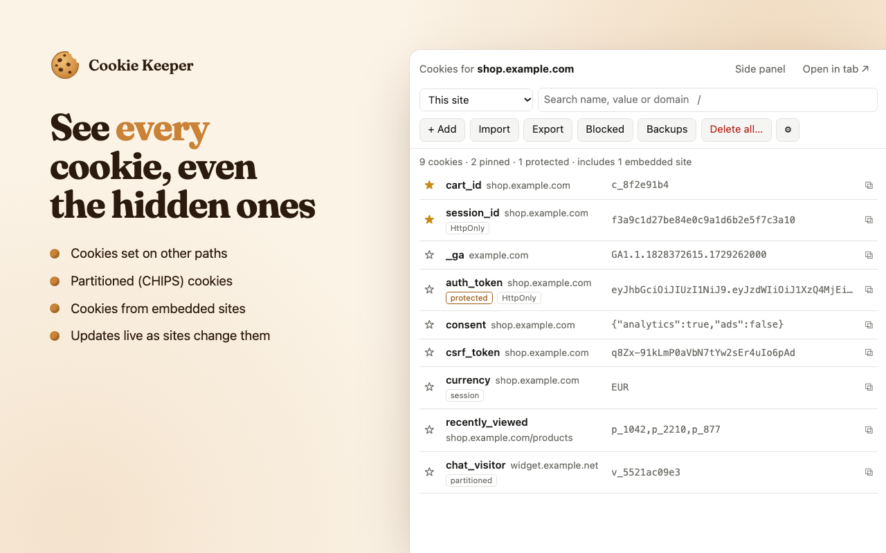
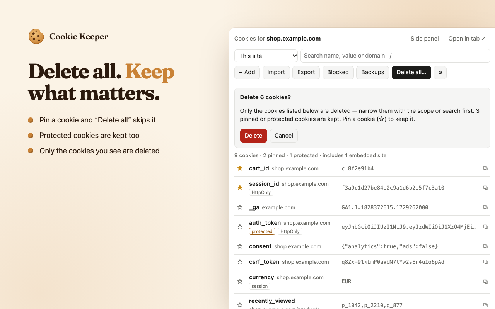
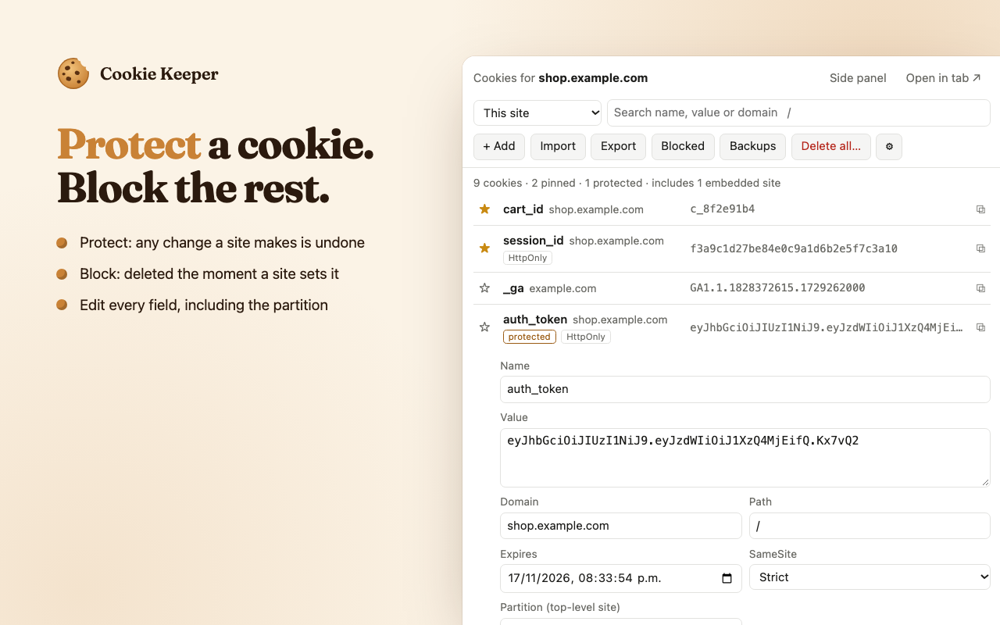
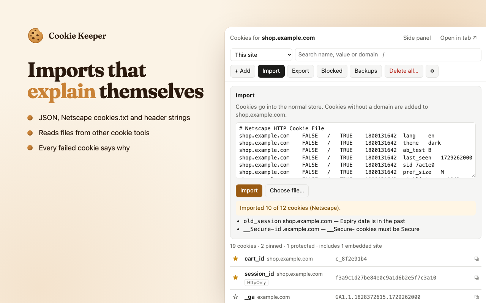
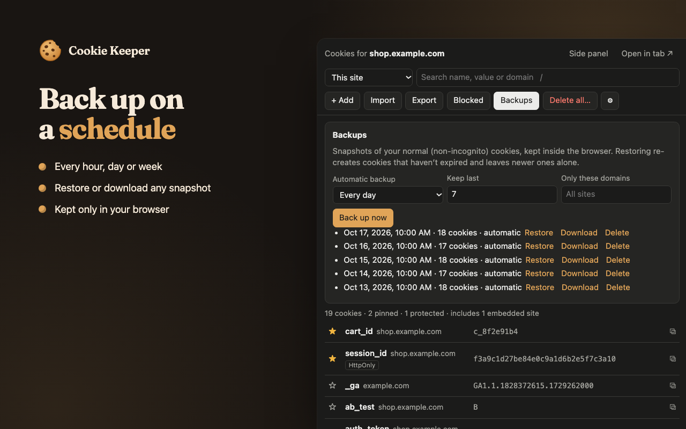

# Cookie Keeper

A free, open-source cookie editor for Chrome, Edge and other Chromium browsers, built from what users kept asking for in cookie editor reviews.

**[Website](https://afieif.github.io/cookie-keeper/)** · [Privacy policy](https://afieif.github.io/cookie-keeper/privacy.html) · [Report an issue](https://github.com/afieif/cookie-keeper/issues)

## Features

- **Every cookie:** one site, a site and its subdomains, or every site, including ones that are easy to miss: other paths, partitioned (CHIPS) cookies and cookies from embedded sites.
- **Full editor:** change every field, copy a value in one click, search by name, value or domain.
- **Pin:** keep important cookies at the top, and "Delete all" leaves them alone.
- **Protect:** if a site changes or deletes a protected cookie, it's put back straight away.
- **Block:** a blocked cookie is deleted the moment a site sets it.
- **Import & export:** JSON, Netscape cookies.txt or a header string, for one site or all of them. Failed imports tell you why.
- **Backups:** back up now or on a schedule, and restore with one click.
- **Your way:** popup, side panel, full tab or a DevTools tab; incognito support; light and dark themes.

## Screenshots

| | |
|---|---|
|  |  |
|  |  |

## Privacy

Cookie Keeper has no servers and makes no network requests. No analytics, no ads, no accounts: your cookies never leave your browser. See the [privacy policy](PRIVACY.md).

## Install

Cookie Keeper is coming to the Chrome Web Store. Until then:

1. Download this repository (**Code → Download ZIP**) and unzip it.
2. Open `chrome://extensions` and turn on **Developer mode**.
3. Click **Load unpacked** and choose the folder.

## Contributing

Bug reports and feature requests are welcome in [issues](https://github.com/afieif/cookie-keeper/issues). For the project layout and build scripts, see [CONTRIBUTING.md](CONTRIBUTING.md).

## License

[MIT](LICENSE)
